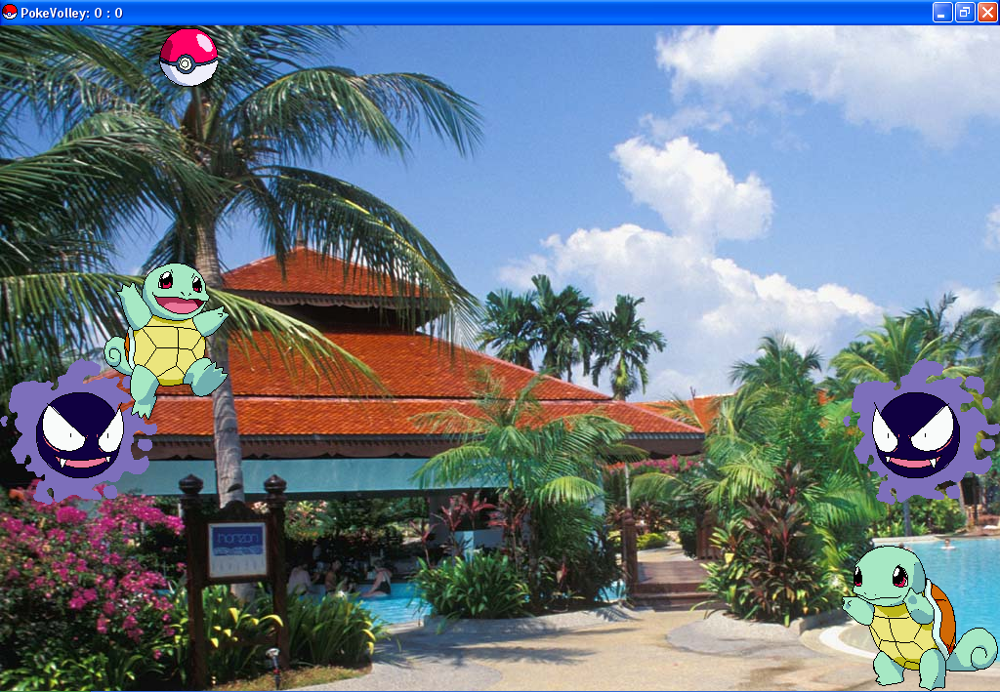

# PokeVolley (VCL)

PokeVolley (VCL) is one of [Richèl Bilderbeek's games](https://richelbilderbeek.github.io/games/).

The game PokeVolley, using the C++ VCL library.

## Screenshots

## Links

- [Source code](https://github.com/richelbilderbeek/PokeVolleyVcl)
